# CAFA-TTA

### Confidence-Aware Feature Alignment for Test-Time Adaptation in Cross-Domain Medical Image Classification


An experimental framework for confidence-aware entropy minimization and source-prototype feature alignment in unsupervised test-time adaptation for medical image classification.

---

## Overview

Medical image classification models may experience performance degradation when deployed on data distributions that differ from their training distributions.

Test-time adaptation (TTA) attempts to reduce this degradation by adapting pretrained models using unlabeled target samples.

CAFA-TTA investigates whether confidence-aware feature alignment can provide additional improvements beyond conventional test-time entropy minimization (TENT).

The final proposed method, **CAFA-TTA v3**, combines:

- Confidence-weighted entropy minimization.
- Source class prototypes.
- Classifier-prototype agreement.
- Confidence-aware feature alignment.
- Batch-normalization affine parameter adaptation.
- Online batch-prequential evaluation.

The framework is evaluated on PathMNIST and an external six-category subset of STARC-9.

**Research status:** Experimental research prototype. The method has not been clinically validated or independently replicated.

---

## Research Highlights

| Research Component | Scope |
|---|---:|
| Evaluation datasets | 2 |
| Trained ResNet-18 checkpoints | 4 |
| Final source model variants | 3 |
| Adaptation seeds | 3 |
| PathMNIST evaluation conditions | 13 |
| Final prediction files | 453 |
| Paired CAFA v3 vs TENT comparisons | 126 |
| Factorial ablation runs | 36 |
| Computational benchmark runs | 36 |
| Research figures | 22 |
| Selected research CSV tables | 28 |

All 453 original final prediction files passed local integrity and structural content verification.

The paired comparisons reuse underlying evaluation samples and should not be interpreted as statistically independent experiments.

---

## Table of Contents

- [Motivation](#motivation)
- [Methodology](#methodology)
- [Experimental Setup](#experimental-setup)
- [Main Results](#main-results)
- [External Evaluation](#external-evaluation)
- [Ablation Study](#ablation-study)
- [Statistical Analysis](#statistical-analysis)
- [Computational Efficiency](#computational-efficiency)
- [Negative Adaptation](#negative-adaptation)
- [Installation](#installation)
- [Quick Start](#quick-start)
- [Repository Structure](#repository-structure)
- [Reproducibility](#reproducibility)
- [Documentation](#documentation)
- [Limitations](#limitations)
- [Future Work](#future-work)
- [Citation](#citation)
- [License](#license)

---

## Motivation

Entropy minimization is a practical approach to unsupervised test-time adaptation.

However, minimizing prediction entropy alone may reinforce incorrect predictions under distribution shift.

Hard confidence filtering may also discard informative target samples.

CAFA-TTA explores two complementary mechanisms:

1. Soft confidence weighting for the entropy objective.
2. Confidence-aware alignment with source prototypes when classifier and prototype predictions agree.

The central research question is whether these mechanisms provide consistent incremental improvements over TENT while retaining a practical computational footprint.

---

## Methodology

### Method Evolution

| Version | Main Mechanism |
|---|---|
| CAFA v1 | Confidence-aware feature alignment |
| CAFA v2 | Confidence filtering and classifier-prototype agreement |
| CAFA v3 | Soft entropy weighting and agreement-gated feature alignment |

CAFA-TTA v3 is the final proposed method.

Earlier versions are preserved for comparison and research transparency.

### Adaptation Pipeline

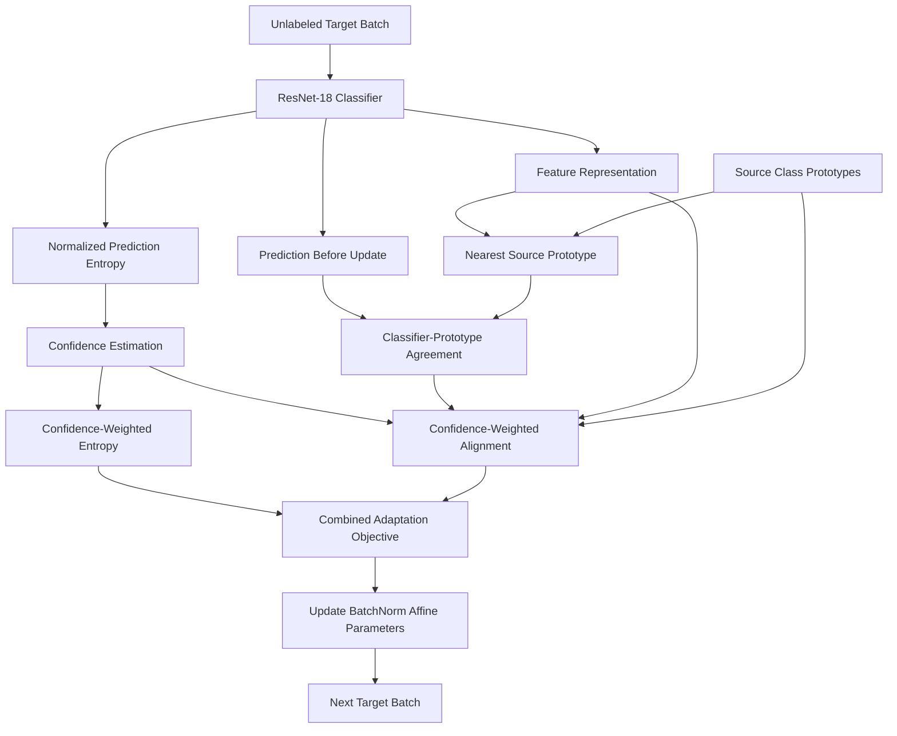

### Confidence Estimation

For a classifier prediction distribution p over K source classes:

    confidence = 1 - H(p) / log(K)

where H denotes prediction entropy.

This confidence score is an entropy-derived heuristic rather than a calibrated probability of prediction correctness.

### Confidence-Weighted Entropy

CAFA-TTA v3 assigns each target sample a nonzero entropy weight:

    w_entropy = alpha + (1 - alpha) * confidence

where alpha is the entropy floor.

The weighted entropy objective is normalized by the sum of the sample weights.

Unlike hard confidence rejection, the nonzero floor allows lower-confidence samples to retain a contribution to the entropy objective.

### Source Prototype Alignment

Source class prototypes are constructed using labeled source training features.

Each prototype is a normalized class-level feature mean.

During adaptation:

1. Extract the target feature representation.
2. Determine the classifier-predicted class.
3. Identify the nearest source prototype using cosine similarity.
4. Check classifier-prototype agreement.
5. Weight valid alignment samples by confidence.

The alignment objective is skipped when the required minimum number of agreement samples is not satisfied.

### Combined Objective

    L_total = L_weighted_entropy + lambda_align * L_alignment

Only batch-normalization affine parameters are optimized.

Target ground-truth labels are not used in parameter adaptation.

The implementation is provided in:

- [CAFA-TTA v1](core/cafa_adapter.py)
- [CAFA-TTA v2](core/cafa_agreement_adapter.py)
- [CAFA-TTA v3](core/cafa_soft_adapter.py)
- [TENT baseline](kernel/tent.py)

---

## Experimental Setup

### Datasets

| Property | PathMNIST | STARC-9 |
|---|---|---|
| Modality | Histopathology | Histopathology |
| Research role | Source training and evaluation | External evaluation |
| Evaluation samples | 7,180 | 12,000 |
| Target categories | 9 | 6 |
| Model output classes | 9 | 9 |
| Input size | 28 x 28 RGB | Resized to 28 x 28 RGB |
| Synthetic corruption | Yes | No |

PathMNIST contains:

- 89,996 source training images.
- 10,004 validation images.
- 7,180 test images.

The external STARC-9 evaluation uses six approximately corresponding tissue categories selected from a pinned, stain-normalized Stanford validation archive.

All nine source classifier outputs and source prototypes remain available during external evaluation.

Dataset information and attribution requirements are documented in [Dataset Licenses](docs/DATASET_LICENSES.md).

### Source Models

Three related source model variants are used in the final adaptation experiments.

| Model | Training Strategy | Validation Accuracy |
|---|---|---:|
| Enhanced | Augmentation-enhanced fine-tuning | 95.40% |
| Robust | Strong color augmentation | 89.57% |
| Balanced | Moderate color augmentation | 93.11% |

The Enhanced model is initialized from the original baseline checkpoint.

The Robust and Balanced models are separately fine-tuned from the Enhanced model.

These models share a training lineage and are not independent training replications.

### Frozen Configuration

| Parameter | Value |
|---|---|
| Backbone | ResNet-18 |
| Feature dimension | 512 |
| Source classes | 9 |
| Batch size | 64 |
| Adaptation learning rate | 0.0001 |
| Entropy floor | 0.2 |
| Alignment weight | 0.05 |
| Minimum agreement samples | 2 |
| Random seeds | 42, 123, 2026 |
| Protocol | Online batch-prequential |

See the [frozen configuration](experiments/reproducibility/final_config.json).

### Evaluation Protocol

The final evaluation follows a predict-before-update protocol.

For each target batch:

1. Generate predictions.
2. Record the predictions.
3. Adapt the model using unlabeled target samples.
4. Continue to the next batch.

Target batch statistics may depend on other samples within the current batch.

The protocol is therefore batch-prequential rather than strictly individual-sample causal.

The source model and adaptation optimizer are reset between independent evaluation runs.

---

## Main Results

### PathMNIST Final Evaluation

The final PathMNIST analysis includes 117 unique paired TENT versus CAFA-TTA v3 comparisons across three source models, three seeds, and 13 evaluation conditions.

| Metric | CAFA v3 vs TENT |
|---|---:|
| Mean accuracy improvement | +0.0621 pp |
| Mean macro-F1 improvement | +0.0448 pp |
| Accuracy wins | 95 |
| Accuracy ties | 11 |
| Accuracy losses | 11 |
| Corrected predictions | 812 |
| Harmed predictions | 290 |
| Net corrected predictions | 522 |
| Corrected-to-harmed ratio | 2.80 |

Here, pp denotes percentage points.

The observed incremental improvement is positive on average but small in absolute magnitude.

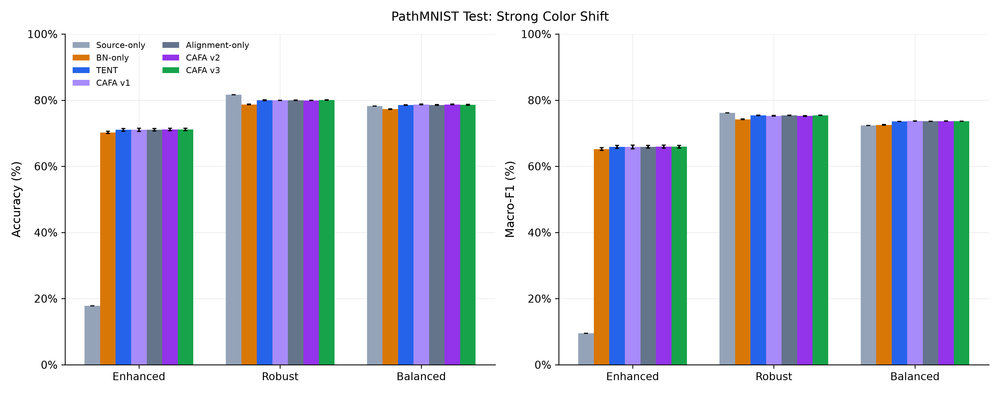

### Strong Color Shift

Mean classification accuracy:

| Method | Enhanced | Robust | Balanced |
|---|---:|---:|---:|
| Source-only | 17.84% | 81.63% | 78.22% |
| BN-only | 70.25% | 78.70% | 77.27% |
| TENT | 71.03% | 79.97% | 78.52% |
| CAFA v1 | 71.03% | 79.93% | 78.69% |
| Alignment variant | 71.07% | 79.97% | 78.56% |
| CAFA v2 | 71.15% | 79.91% | 78.71% |
| CAFA v3 | 71.12% | 80.01% | 78.60% |

CAFA v3 does not achieve the highest accuracy for every source model.

The Robust source-only classifier outperforms all adaptation methods in this strong color-shift condition.

Most of the Enhanced model recovery is associated with batch normalization and entropy adaptation rather than the incremental CAFA v3 contribution alone.

### Shift Severity

| Color Shift | Mean Accuracy Gain vs TENT |
|---|---:|
| Original | +0.032 pp |
| Light | +0.036 pp |
| Medium | +0.082 pp |
| Strong | +0.071 pp |

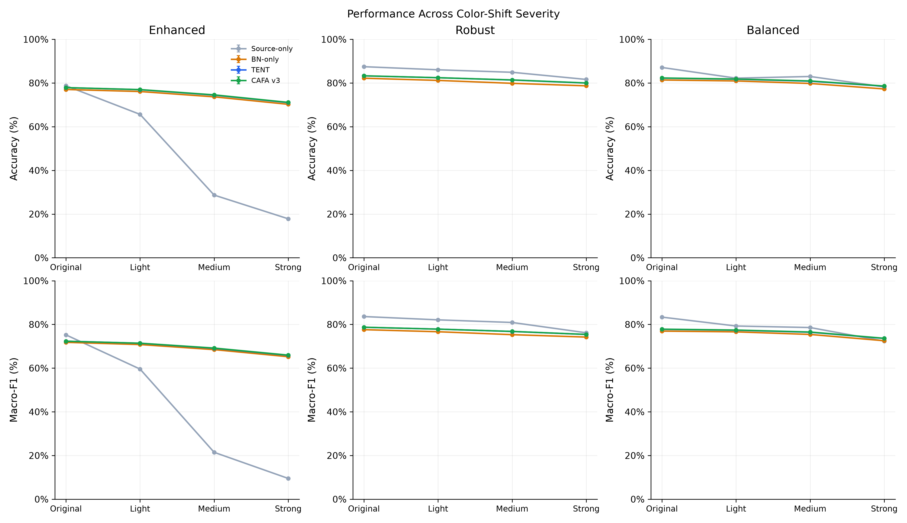

### Multiple Corruptions

| Corruption | Paired Comparisons | Mean Accuracy Gain |
|---|---:|---:|
| Gaussian noise | 27 | +0.0830 pp |
| Gaussian blur | 27 | +0.0763 pp |
| Hue shift | 27 | +0.0361 pp |

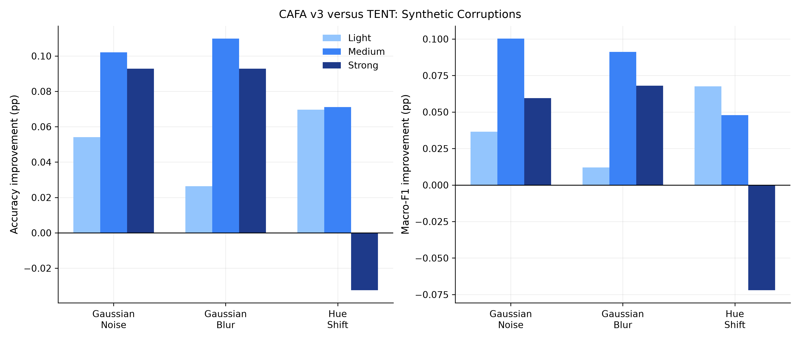

The improvements are less consistent under hue shift than under Gaussian noise and Gaussian blur.

Repeated strong-shift records are excluded from the final paired aggregation.

---

## External Evaluation

### STARC-9

A selected external STARC-9 subset is used to evaluate the final frozen CAFA-TTA v3 configuration.

The evaluation contains:

- 12,000 target images.
- Six target tissue categories.
- 2,000 samples per category.
- Nine source classifier outputs.
- Three related source models.
- 30 total evaluation runs.
- Nine paired TENT versus CAFA v3 comparisons.

No synthetic corruption is applied.

The external protocol is frozen before model evaluation.

Target labels are used for subset selection and metric calculation, not adaptation optimization.

### External Accuracy

| Model | Source-only | BN-only | TENT | CAFA v3 |
|---|---:|---:|---:|---:|
| Enhanced | 22.3250% | 55.0139% | 56.4472% | 56.5917% |
| Robust | 73.4000% | 71.8806% | 74.1222% | 74.2278% |
| Balanced | 72.2583% | 69.4028% | 71.6278% | 71.7111% |

### External Six-Class Macro-F1

| Model | Source-only | BN-only | TENT | CAFA v3 |
|---|---:|---:|---:|---:|
| Enhanced | 19.4651% | 60.3133% | 61.3416% | 61.4669% |
| Robust | 76.3687% | 76.7877% | 78.2515% | 78.3286% |
| Balanced | 74.2878% | 75.1022% | 76.6929% | 76.7495% |

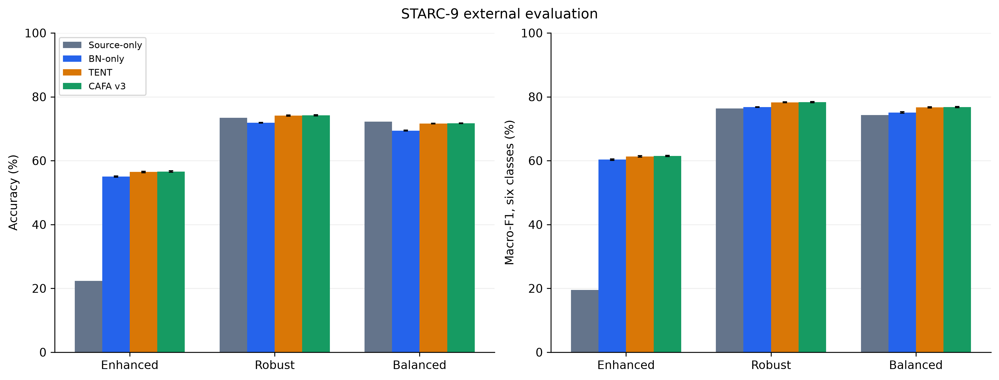

### Paired External Improvements

| Model | Accuracy Gain | Macro-F1 Gain |
|---|---:|---:|
| Enhanced | +0.144444 pp | +0.125346 pp |
| Robust | +0.105556 pp | +0.077075 pp |
| Balanced | +0.083333 pp | +0.056611 pp |
| Overall | +0.111111 pp | +0.086344 pp |

CAFA v3 improves both accuracy and six-class macro-F1 in all nine paired external comparisons.

However, the Balanced model retains negative accuracy adaptation relative to source-only.

The Robust model achieves the highest absolute external performance among the evaluated source models.

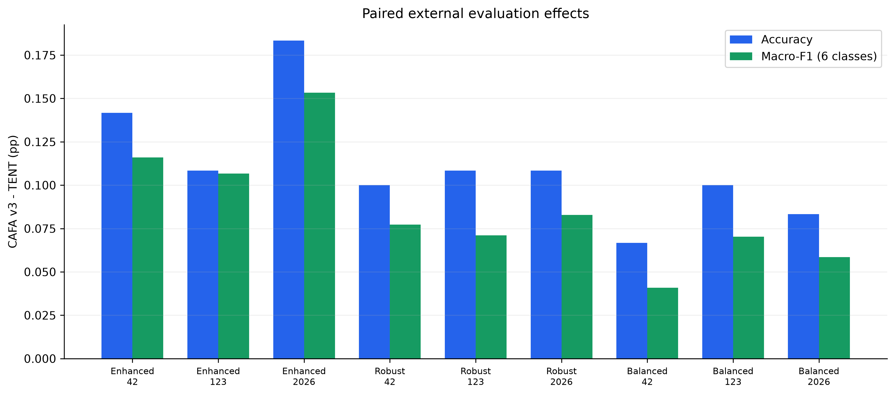

### External Duplicate Sensitivity

The selected external subset contains 49 exact duplicate image groups.

Sensitivity analysis using one representative per pixel group or equal group weighting retains a positive average accuracy difference.

This analysis changes the scoring procedure without rerunning adaptation.

It does not establish how duplicate removal would affect adaptation dynamics.

### Absent Source Classes

Three source output classes are absent from the selected six-category external target subset.

These outputs remain available and are counted as errors when predicted.

CAFA v3 reduces the mean absent-class prediction rate by approximately 0.0926 percentage points relative to TENT.

The external evaluation provides evidence from an additional dataset but does not establish universal cross-hospital generalization.

---

## Ablation Study

The factorial ablation evaluates confidence-weighted entropy and source-prototype alignment.

| Configuration | Entropy Floor | Alignment Weight |
|---|---:|---:|
| Entropy baseline | 1.0 | 0.00 |
| Soft entropy | 0.2 | 0.00 |
| Alignment-enabled entropy | 1.0 | 0.05 |
| Full CAFA v3 | 0.2 | 0.05 |

The experiment contains 36 validation runs.

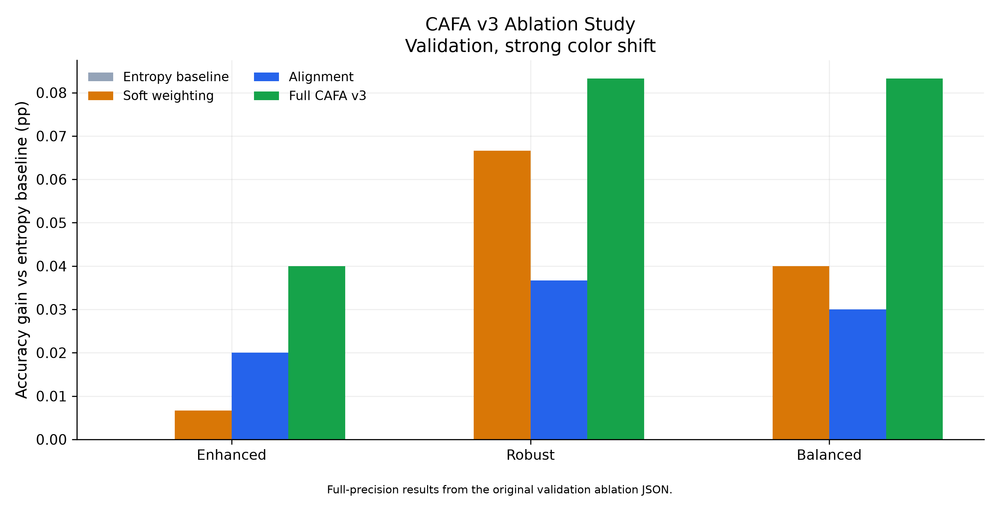

The evaluated objective components provide small improvements under the selected shuffled strong-shift validation protocol.

Their effects are not uniformly additive.

The alignment-enabled variant retains entropy minimization and should not be interpreted as a pure alignment-only method.

Detailed results are available in the [verified ablation table](experiments/research_outputs/tables/table04_ablation_verified.csv).

---

## Statistical Analysis

The paired statistical analysis uses:

- Exact McNemar tests.
- Holm multiple-comparison correction.
- Conditional image-index bootstrap.
- Circular block bootstrap.
- Leave-one-group-out sensitivity analysis.
- Per-class performance analysis.

### Summary

| Metric | PathMNIST | STARC-9 |
|---|---:|---:|
| Paired comparisons | 117 | 9 |
| Accuracy wins | 95 | 9 |
| Accuracy ties | 11 | 0 |
| Accuracy losses | 11 | 0 |
| Mean accuracy gain | +0.0621 pp | +0.111111 pp |
| Mean macro-F1 gain | +0.0448 pp | +0.086344 pp |
| Corrected predictions | 812 | 141 |
| Harmed predictions | 290 | 21 |
| Net corrected predictions | 522 | 120 |
| Unadjusted p-values below 0.05 | 31 | 9 |
| Holm-adjusted p-values below 0.05 | 1 | 9 |

### Conditional Bootstrap Intervals

The overall conditional 95% bootstrap intervals for the mean accuracy differences are:

| Dataset | Conditional 95% Interval |
|---|---|
| PathMNIST | [+0.0539, +0.0705] pp |
| STARC-9 | [+0.087963, +0.134259] pp |

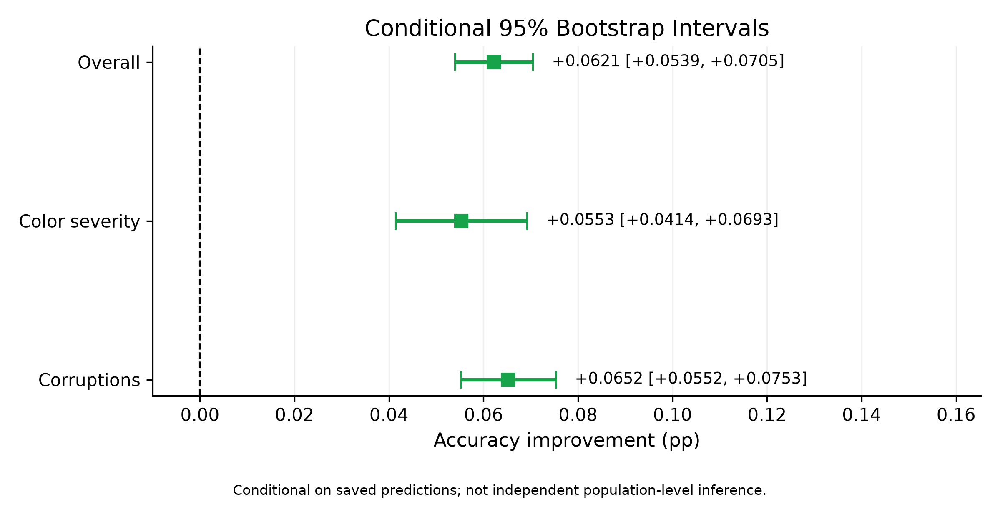

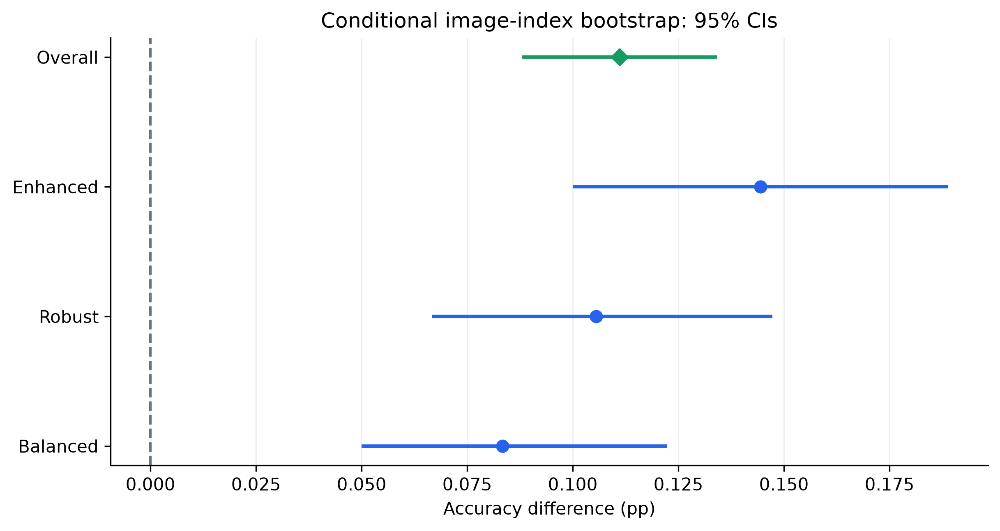

These intervals are conditional on the saved evaluation samples and adaptation trajectories.

Repeated samples, sequential adaptation, duplicate images, and unavailable patient-level clustering information limit inferential interpretation.

The tests are exploratory rather than confirmatory clinical evidence.

No pooled statistical significance claim is made across the two datasets.

### Per-Class Performance

PathMNIST class-level results show heterogeneous effects, including improvements and degradations in recall.

The higher-support classes account for most net corrected predictions.

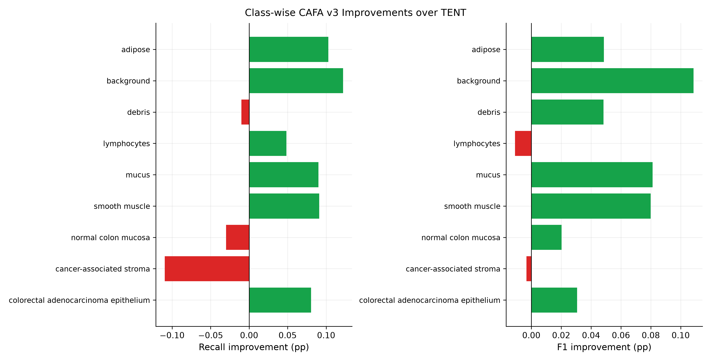

On the selected external subset, five of six tissue categories improve in both mean recall and F1.

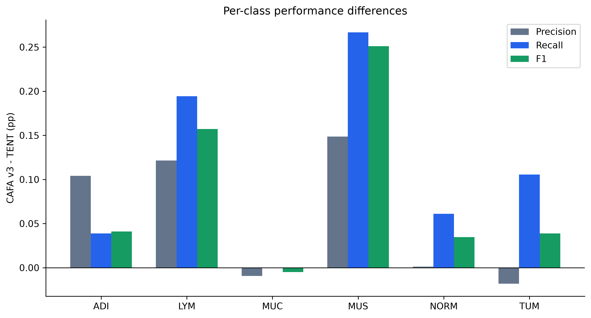

These findings do not establish improved rare-disease recognition or clinical fairness.

---

## Computational Efficiency

The reference computational benchmark uses an NVIDIA GeForce RTX 3050 Laptop GPU with 4 GB of GPU memory.

| Model | TENT (ms/batch) | CAFA v3 (ms/batch) | Overhead |
|---|---:|---:|---:|
| Enhanced | 10.637 | 14.705 | 38.25% |
| Robust | 10.515 | 14.097 | 34.07% |
| Balanced | 9.765 | 14.197 | 45.39% |

Additional characteristics:

- Batch size: 64.
- Trainable BatchNorm affine parameters: 9,600.
- Float32 source prototype storage: 18 KiB.
- Additional peak allocated GPU memory: approximately 0.40 to 0.52 MiB relative to TENT.

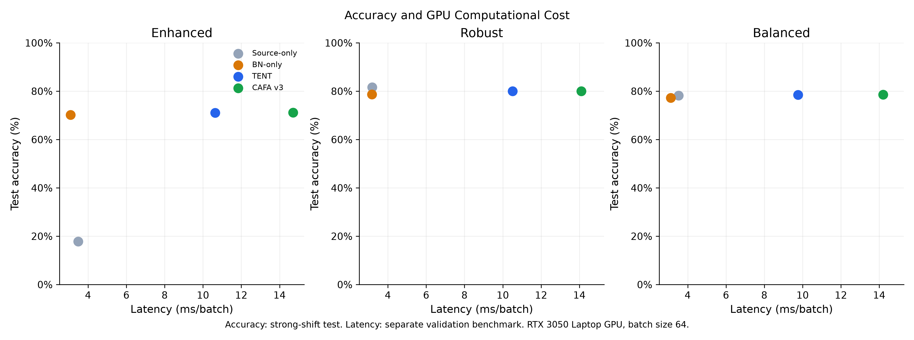

The runtime overhead must be considered alongside the small absolute accuracy gains.

The timing measurements use a validation workload and exclude data loading, transfer, and preprocessing.

They do not represent end-to-end clinical deployment latency.

---

## Negative Adaptation

Positive incremental performance relative to TENT does not necessarily imply positive adaptation relative to source-only.

Across the 39 evaluated PathMNIST model-condition groups:

| Method | Negative Accuracy Groups | Negative Macro-F1 Groups |
|---|---:|---:|
| BN-only | 15 | 14 |
| TENT | 15 | 14 |
| CAFA v3 | 15 | 14 |

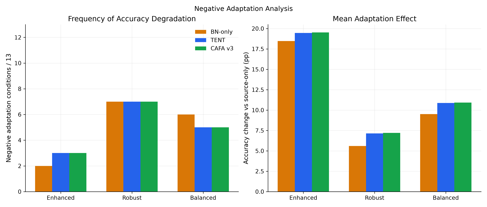

For the external evaluation:

| Method | Negative Accuracy Comparisons |
|---|---:|
| BN-only | 6/9 |
| TENT | 3/9 |
| CAFA v3 | 3/9 |

CAFA-TTA does not eliminate negative adaptation.

Selecting when adaptation should occur remains an important open research problem.

---

## Installation

### Reference Environment

| Component | Version |
|---|---|
| Operating system | Windows |
| Python | 3.12.10 |
| PyTorch | 2.10.0+cu128 |
| Torchvision | 0.25.0+cu128 |
| CUDA | 12.8 |
| cuDNN | 9.10.2 |
| GPU | NVIDIA RTX 3050 Laptop GPU |

### Clone the Repository

```bash
git clone https://github.com/dtc245200063-alt/CAFA-TTA.git
cd CAFA-TTA
```

### Create a Virtual Environment

```bash
python -m venv .venv
```

Activate on Windows PowerShell:

```powershell
.\.venv\Scripts\Activate.ps1
```

### Install CUDA-Enabled PyTorch

```bash
python -m pip install torch==2.10.0 torchvision==0.25.0 --index-url https://download.pytorch.org/whl/cu128
```

### Install Pinned Dependencies

```bash
python -m pip install -r requirements.txt
```

### Verify the Environment

```bash
python -m pip check
python scripts/check_cuda.py
```

Installation in a fresh environment has not yet been independently verified.

See the complete [Reproducibility Guide](docs/REPRODUCIBILITY.md) for the reference environment, dependencies, dataset preparation, and artifact requirements.

---

## Quick Start

The following commands describe the original experimental entry points.

Original datasets, compatible source checkpoints, prototypes, and required metadata must be restored before executing the corresponding evaluations.

Run experiments in a separate workspace to avoid overwriting the frozen research outputs.

### Prepare PathMNIST

```bash
python scripts/download_data.py
```

### Train Source Models

```bash
python scripts/train_baseline.py
python scripts/train_enhanced.py
python scripts/train_robust.py
python scripts/train_balanced.py
```

The training sequence requires the appropriate initialization checkpoint at each stage.

### Extract Source Prototypes

```bash
python scripts/extract_prototypes_models.py
```

### Run Final PathMNIST Evaluations

```bash
python scripts/evaluate_cafa_final_test.py
python scripts/evaluate_cafa_final_test_severity.py
python scripts/evaluate_cafa_final_test_corruptions.py
```

Run the strong-shift evaluation before the severity evaluation because compatible strong-shift results are reused.

### Verify Predictions and Analyze Results

```bash
python scripts/verify_final_test_predictions.py
python scripts/analyze_statistical_significance.py
python scripts/analyze_per_class_performance.py
python scripts/generate_research_figures.py
```

### Prepare and Evaluate STARC-9

After obtaining the pinned archive and restoring the required original dataset metadata:

```bash
python scripts/prepare_starc9_dataset.py
python scripts/evaluate_starc9_external.py
python scripts/analyze_starc9_external.py
```

The external evaluator checks frozen configuration and artifact hashes.

Equivalent regenerated artifacts may not be byte-identical to the original files.

Do not bypass frozen integrity checks by replacing the original reference hashes.

### Run Ablation and Efficiency Experiments

```bash
python scripts/evaluate_cafa_v3_ablation.py
python scripts/benchmark_cafa_v3.py
```

The commands above document the intended execution workflow rather than a certified one-command reproduction pipeline.

---

## Continual Learning Extension (Experimental)

An experimental extension, separate from the frozen research pipeline, explores continual learning across modalities (histopathology, dermatology, chest X-ray, fundus, hematology, breast ultrasound) at 224x224. It never writes `checkpoints/` or `experiments/`.

- Online: during a session, BatchNorm running statistics follow the incoming images by EMA from a class-balanced memory (latest images per predicted class, RoTTA-style), and CAFA-TTA v3 adapts BatchNorm affine parameters on buffered batches of images that pass the OOD gate.
- Safety: images flagged out-of-distribution (energy score and prototype similarity) are never learned from by gradient, and the session resets to the source model when its predictions drift.
- Persistent: user-confirmed labels and capped, confident pseudo-labels are consolidated offline with source-data replay and distillation. A new model version is promoted only if it does not regress on a fixed validation split, and earlier versions can be restored.

```bash
python scripts/train_modality.py --modality histopathology --data-dir <ImageFolder> --augment strong
python -m pip install -r requirements-demo.txt
python app/demo_gradio.py --data-root <folder with kather2016/ and crc_val_he_7k/>
python scripts/consolidate.py --modality histopathology --source-data-dir <ImageFolder>
```

Evaluation scripts (outputs go to `runs/`, which is gitignored):

| Script | What it measures |
| --- | --- |
| `scripts/evaluate_histopathology_external.py` | CRC-VAL-HE-7K (clean and colour-shifted), Kather 2016 static and online streams (shuffled and class-ordered, 3 seeds), synthetic non-tissue rejection |
| `scripts/build_showcase.py` | Image-by-image before/after on Kather 2016 (first model vs current model with adaptation) |
| `scripts/continual_resnet.py` | Consolidation rounds from unlabelled Kather 2016 patients 01, 03, 05, 06, 07, 09; scored on patients 02, 04, 08, 10, which are never used for learning |
| `scripts/extract_foundation_features.py`, `scripts/evaluate_foundation.py`, `scripts/continual_foundation.py` | Comparison with a frozen pathology foundation model (Phikon, ViT-B/16) plus a linear head, feature-level TTA (class-balanced statistics, T3A) and the same consolidation protocol |

Kather 2016 is scored two ways. Strict scoring counts the NCT classes MUC (mucus) and MUS (smooth muscle) as errors, because Kather 2016 has no such classes. Harmonised scoring follows the Kather 2016 class definitions (Sci Rep 6:27988), where "debris" includes necrosis, haemorrhage and mucus and "simple stroma" includes smooth muscle, so MUC counts as DEB and MUS as STR. Both are reported. Kather 2016 is one external dataset; seeds are paired, not independent runs; the class-ordered stream is simulated by sorting labels, not real cases; nothing here is clinically validated.

The demo (`app/demo_gradio.py`, bound to 127.0.0.1) has tabs for the before/after showcase, the consolidation rounds, single-image analysis, a side-by-side two-image comparison, a labelled live test of source / BN-adapt / CAFA v3 / the session, and the saved results (`--results-dir`, default `runs/final`).

The Phikon weights (owkin/phikon, Owkin non-commercial licence, research use only) are downloaded separately into `data/foundation/phikon/` and are never committed.

---

## Repository Structure

```text
CAFA-TTA/
|
|-- core/
|   |-- cafa_adapter.py
|   |-- cafa_agreement_adapter.py
|   |-- cafa_soft_adapter.py
|   |-- training_utils.py
|   |-- trainer.py            # Continual line: training loop, calibration
|   |-- continual.py          # Online session, OOD gate, experience store
|   `-- registry.py           # Model versions, promotion gate, rollback
|
|-- app/
|   `-- demo_gradio.py        # Continual-learning demo (local only)
|
|-- kernel/
|   |-- confidence.py
|   |-- feature_alignment.py
|   `-- tent.py
|
|-- models/
|   `-- feature_extractor.py
|
|-- scripts/
|   |-- Source training
|   |-- Prototype extraction
|   |-- Adaptation evaluation
|   |-- Statistical analysis
|   |-- Research figure generation
|   |-- check_cuda.py         # Environment check
|   `-- legacy/               # Superseded v1/v2, BN-only and TENT scripts
|
|-- experiments/
|   |-- reproducibility/
|   |-- cafa_v3_ablation/
|   |-- cafa_v3_benchmark/
|   |-- cafa_final_test_strong/
|   |-- cafa_final_test_severity/
|   |-- cafa_final_test_corruptions/
|   |-- statistical_analysis/
|   |-- research_outputs/
|   `-- starc9_external/
|
|-- docs/
|   |-- DATASET_LICENSES.md
|   |-- REPRODUCIBILITY.md
|   |-- CHECKPOINTS.md
|   `-- EXPERIMENTS.md
|
|-- tests/
|-- data/                  # Local dataset storage
|-- checkpoints/           # Local model artifacts
|-- requirements.txt
|-- requirements-dev.txt
|-- .gitignore
`-- README.md
```

The directory tree is a logical overview.

Local medical datasets, model weights, and other excluded artifacts are not necessarily present in a fresh repository clone.

---

## Reproducibility

The project preserves the original research configuration and artifact integrity records.

### Original Local Audit Results

| Artifact | Verification |
|---|---|
| Model checkpoints and prototypes | 8/8 |
| PathMNIST prediction files | 423/423 |
| STARC-9 prediction files | 30/30 |
| PathMNIST research manifest inputs | 15/15 |
| PathMNIST research manifest outputs | 42/42 |
| STARC-9 statistical manifest inputs | 35/35 |
| STARC-9 statistical manifest outputs | 36/36 |

### Reproducibility Records

- [Frozen configuration](experiments/reproducibility/final_config.json)
- [Frozen dependencies](experiments/reproducibility/requirements_frozen.txt)
- [Checkpoint hashes](experiments/reproducibility/checkpoint_hashes.csv)
- [Algorithm hashes](experiments/reproducibility/algorithm_hashes.csv)
- [PathMNIST research manifest](experiments/research_outputs/research_manifest.json)
- [STARC-9 external protocol](experiments/starc9_external/external_protocol.json)
- [STARC-9 statistical manifest](experiments/starc9_external/statistical_analysis/statistical_manifest.json)

### Artifact Availability

The original research package includes:

- 453 prediction files.
- Four trained checkpoints.
- Four source prototype files.
- 22 distinct research figures.
- PNG and PDF figure formats.
- Statistical tables and reports.

Original checkpoints, prototypes, per-sample predictions, and certain dataset metadata remain subject to availability, redistribution, and privacy review.

No public binary artifact download is asserted at this stage.

Independent reproduction requires access to the relevant original artifacts or an appropriately reconstructed experimental environment.

Retraining may produce different checkpoints and predictions.

The completed local integrity audits do not establish fresh-clone or independent end-to-end reproducibility.

---

## Documentation

| Document | Description |
|---|---|
| [DATASET_LICENSES.md](docs/DATASET_LICENSES.md) | Dataset attribution, licensing, preprocessing, and publication policy |
| [REPRODUCIBILITY.md](docs/REPRODUCIBILITY.md) | Environment, setup, execution workflow, and integrity verification |
| [CHECKPOINTS.md](docs/CHECKPOINTS.md) | Model lineage, prototype construction, and SHA-256 checksums |
| [EXPERIMENTS.md](docs/EXPERIMENTS.md) | Detailed experimental design, results, statistical analyses, and limitations |

### Research Outputs

- [PathMNIST figures](experiments/research_outputs/figures/)
- [PathMNIST research tables](experiments/research_outputs/tables/)
- [Research findings](experiments/research_outputs/research_findings.md)
- [Research limitations](experiments/research_outputs/research_limitations.md)
- [Future work](experiments/research_outputs/future_work.md)
- [External STARC-9 analysis](experiments/starc9_external/statistical_analysis/)

The research output directories contain the original computational records and should be interpreted together with their associated manifests.

---

## Limitations

The current study has the following important limitations:

1. Absolute improvements over TENT are small.

2. The PathMNIST test set had been accessed during earlier method development.

3. Multiple experimental conditions reuse the same underlying image samples.

4. Source models share a related training lineage.

5. Adaptation seeds do not capture independent source training variability.

6. Entropy-derived confidence is not a calibrated probability of correctness.

7. Statistical analyses are exploratory and conditional on saved adaptation trajectories.

8. Patient-level and slide-level clustering information is unavailable.

9. The external STARC-9 evaluation uses a selected six-category subset with an approximate semantic label mapping.

10. Exact duplicate images are present in the external dataset.

11. Low-resolution 28 x 28 input images lose substantial histopathological detail.

12. STARC-9 images are stain-normalized, limiting the evaluated domain-shift scope.

13. CAFA-TTA introduces additional runtime overhead.

14. Negative adaptation remains unresolved.

15. Independent clean-environment reproduction has not yet been completed.

16. Additional architectures, medical imaging modalities, and adaptation baselines remain to be evaluated.

The results do not establish universal superiority, patient-level diagnostic performance, clinical safety, or clinical effectiveness.

---

## Future Work

Potential research extensions include:

- Negative-adaptation detection.
- Adaptive alignment strength.
- Improved uncertainty estimation.
- Class-balanced adaptation.
- Continual test-time adaptation.
- Nonstationary target streams.
- Additional adaptation baselines.
- Multiple independent source training seeds.
- Higher-resolution histopathology evaluation.
- Alternative backbone architectures.
- Patient-level and slide-level validation.
- Independent external replication.
- Improved computational efficiency.

These directions represent proposed future research rather than completed experiments.

---

## Citation

CAFA-TTA is an ongoing research project.

A formal paper citation or DOI is not available at this stage.

Software citation metadata is provided in [CITATION.cff](CITATION.cff).

When referencing this implementation, identify the project title, repository URL, and exact commit or release version used.

Repository:

https://github.com/dtc245200063-alt/CAFA-TTA

### Related Research

**TENT**

Wang, D., Shelhamer, E., Liu, S., Olshausen, B., and Darrell, T.

Tent: Fully Test-Time Adaptation by Entropy Minimization.

International Conference on Learning Representations, 2021.

https://arxiv.org/abs/2006.10726

**MedMNIST v2**

Yang, J., et al.

MedMNIST v2: A large-scale lightweight benchmark for 2D and 3D biomedical image classification.

Scientific Data, 2023.

https://doi.org/10.1038/s41597-022-01721-8

**STARC-9**

STARC-9: A Large-scale Dataset for Multi-Class Tissue Classification for CRC Histopathology.

NeurIPS Datasets and Benchmarks, 2025.

https://arxiv.org/abs/2511.00383

The original dataset creators should be acknowledged according to their respective attribution requirements.

---

## License

The original CAFA-TTA source code is licensed under the [MIT License](LICENSE). See the license file for the complete terms.

Third-party datasets retain their respective licenses and attribution requirements.

Original medical image datasets are not redistributed by this repository.

Model checkpoints, source prototypes, and dataset-derived artifacts are subject to separate distribution and rights review.

See [Dataset Licenses and Attribution](docs/DATASET_LICENSES.md).

---

## Acknowledgments

This project acknowledges the researchers and contributors responsible for:

- TENT.
- ResNet.
- PyTorch.
- MedMNIST.
- NCT-CRC-HE-100K.
- CRC-VAL-HE-7K.
- STARC-9.

The project is independent research and does not imply endorsement by the original dataset or method developers.

---

## Disclaimer

CAFA-TTA is provided for experimental research and educational purposes.

It is not a clinical diagnostic system or a validated medical device.

The reported performance is limited to the evaluated datasets, source models, adaptation protocols, and computational environment.

---

## Research Conclusion

CAFA-TTA v3 demonstrates small positive average improvements over TENT across the evaluated PathMNIST conditions and the selected external STARC-9 subset.

The results support further investigation of confidence-weighted entropy and source-prototype alignment.

However, the incremental gains are modest, computational overhead is non-negligible, and negative adaptation remains unresolved.

The project prioritizes transparent reporting, preservation of original experimental evidence, and reproducible research practices.

For artifact availability and reproducibility boundaries, see [Publication Scope](docs/PUBLICATION_SCOPE.md).

Third-party software notices are provided in [THIRD_PARTY_NOTICES.md](THIRD_PARTY_NOTICES.md).

---

## Unified 17-Class ResNet18

The current application uses one ResNet18 checkpoint with 17
dataset-prefixed output classes:

- PathMNIST: 9 classes
- Kather 2016: 8 classes

### Model evaluation

| Dataset | Clean test accuracy | Macro-F1 |
|---|---:|---:|
| PathMNIST | 84.18% | 0.7952 |
| Kather 2016 | 88.29% | 0.8830 |

These results use the balanced 10-epoch training run.
The best checkpoint was selected using validation performance.

### Windows GUI

Run:

```powershell
.\OPEN-CAFA-TTA-GUI.bat
```

The GUI uses `checkpoints/cafa_unified_balanced_best.pt`.

The default inference mode is Source Only.
CAFA Hybrid-BN and automatic shift detection remain experimental
and are not enabled in the GUI.

### Datasets

PathMNIST can be prepared with:

```powershell
python scripts/download_data.py
```

Kather 2016 is available from:
https://zenodo.org/records/53169

Prepare it with:

```powershell
python scripts/prepare_kather2016.py
```

Kather uses a deterministic per-class split with seed 42:
3,496 training, 744 validation and 760 test images.

### Research artifacts

Experiment metrics are stored in:

`experiments/unified_balanced_paper_01/`

The source checkpoint and 17 prototypes are separate files.
See `docs/REPRODUCIBILITY.md` for the broader experimental workflow.

### Limitations

CAFA Hybrid-BN is **not** a default inference method and is not a clinically
validated diagnostic system. See the results below.

### Hybrid-BN results (full test sets, one seed, 17-way head)

| Condition | Dataset | Source-only | BN-only | Hybrid-BN no adaptation | CAFA Hybrid-BN |
|---|---|---:|---:|---:|---:|
| Clean | pathmnist (7,180) | 84.18% | 56.62% | 61.24% | 62.26% |
| Clean | kather (760) | 88.29% | 12.76% | 47.76% | 48.68% |
| Synthetic shift | pathmnist (7,180) | 2.95% | 51.43% | 54.53% | 55.64% |
| Synthetic shift | kather (760) | 28.29% | 13.55% | 38.68% | 38.16% |

Source: `experiments/unified_balanced_paper_01/cafa_hybrid_final_*full_test.json`.

How to read these results:

- CAFA Hybrid-BN **lowers** accuracy on clean images (about -22 pp PathMNIST, -40 pp Kather).
- The gain over BN-only under shift is small on PathMNIST (+4.2 pp). Hybrid-BN mixes
  source and target BatchNorm statistics (target weight alpha: PathMNIST 0.75, Kather 0.25,
  chosen on validation data and per dataset, i.e. the dataset must be known). A non-adaptive Hybrid-BN baseline has now been evaluated on the same
  unified 17-class checkpoint. CAFA improves over that baseline on
  PathMNIST clean and shifted full test after Holm correction, but
  neither Kather comparison is statistically significant.
  A separate unified-model TENT comparison remains outstanding.
- Source-only PathMNIST accuracy under shift (2.95%) is below chance because the 17-way
  head can predict Kather labels; accuracy restricted to the correct dataset's labels
  was not reported.
- Robustness runs over batch orders (101/202/303) and the shift-detector / gated-CAFA
  runs use 128 validation images per dataset. The shift detector flags only about 18%
  of shifted images at a 5% false-alarm rate, and gated CAFA did not help.
- The shift definition used by the different experiment scripts has not been unified;
  numbers from different JSON files should not be compared directly.
- Training hyper-parameters of the committed checkpoint (image size, learning rate,
  batch size, sampler) were not recorded. Runs made with the current `train_unified.py`
  store them under `hyperparameters` in the metrics file.
- The Kather split used here (per-class 70/15/15, seed 42: 3,496 / 744 / 760) differs
  from the split in `docker-project/dataset_splits/kather2016_seed42.json`
  (3,496 / 752 / 752). Do not mix checkpoints or prototypes across the two splits.

The Kather split is image-level and does not establish
patient-level independence.

## Docker environments: CPU, GPU, and unified model

This repository contains separate Docker workflows. They are not interchangeable.

| Workflow | Purpose | Environment | Status |
|---|---|---|---|
| CPU Docker | Legacy PathMNIST 9-class and Kather 8-class experiments | Ubuntu/Linux, Docker Engine and Compose | CPU image build and dependency imports verified on Ubuntu VMware |
| GPU Docker | Legacy PathMNIST baseline, enhanced, robust and balanced training | NVIDIA GPU and compatible container runtime | Compose configuration validated; full GPU build/training not verified |
| Unified ResNet18 | One checkpoint with 17 dataset-prefixed classes | See the unified training scripts and GUI instructions | Checkpoint and Windows GUI inference verified; clean end-to-end training reproduction not verified |

### Docker instructions by operating system

- **Ubuntu/Linux Bash:** follow [Docker CPU instructions](docker-project/README_CPU.md) for CPU experiments.
- **Windows PowerShell:** follow [Docker GPU instructions](docker-project/README.md) only when Docker Desktop, WSL 2 and compatible NVIDIA GPU support are available.
- Docker Engine on Ubuntu may also run the GPU workflow when NVIDIA container support is correctly configured, but this configuration has not been validated here.

Run commands from the directory stated in each Docker README. Bash syntax such as `$PWD` must not be copied unchanged into Windows PowerShell.

### Reproducibility boundaries

Docker CPU and GPU experiments use older pipelines and can have different Kather dataset splits. The unified 17-class model uses its separately documented 3496/744/760 Kather split; do not mix checkpoints, prototypes, or reported test results across these workflows.

Docker Compose validation confirms configuration syntax, not complete training reproducibility. Building an image does not automatically begin training. Dataset files must be obtained separately.

The Windows Tkinter GUI runs outside these Docker containers.
